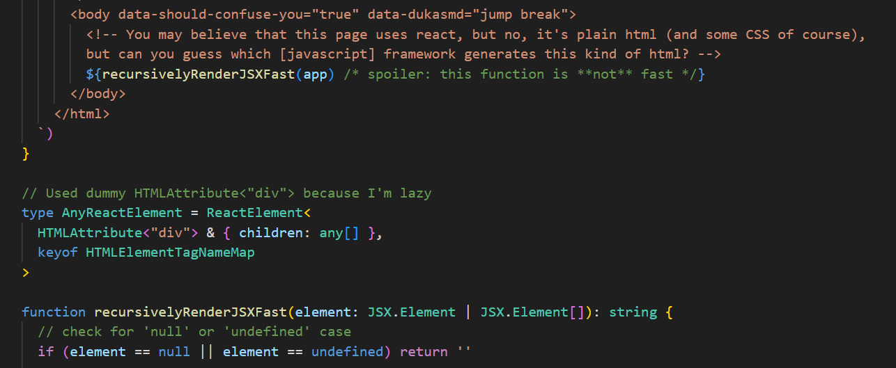

# Uhhh- 
Basically I want to display the project in a clean way, that it.

This project is directly copied from my 1-week hacked-together project for [Introduction to CSS3](https://www.coursera.org/learn/introcss) project: [`04-duck-project-index`](https://github.com/lilunderDuck/glorified-abandonware/tree/main/ritual/04-duck-project-index), a required course that I have to do.

# The same hack as the original project
I wrote a [JSX](https://en.wikipedia.org/wiki/JSX_(programming)) to HTML5 renderer for myself, it was very fun to write the code to handle edge cases.

The same as the chaotic atomic CSS (if you're opening dev-tools right now). Instead of boring random combination of character, it just spill out word from a predefined source set instead. It was fun reading the output of the page :)

Of course, **not production ready**, maybe I might find a crazy arbitrary code execution in the code handles the HTML rendering that can steal your bank account. (Uhhh- maybe not?)

But again, having fun is the best right?

# "Project appeared to be 'disabled'?"
The coursera requirement is strict on what thing I have to put and one it is "have at least 5 images per page", I'm too lazy to find all of the images of my project so I simply "disable" it. I'm just lazy.

# Check out this black magic
You can check out (and give a star I think?) for:
- This one at: [`duck-project-index`](https://github.com/lilunderDuck/projects)
- Original project at: [`scripts/04-duck-project-index`](https://github.com/lilunderDuck/glorified-abandonware/tree/main/scripts/04-duck-project-index)